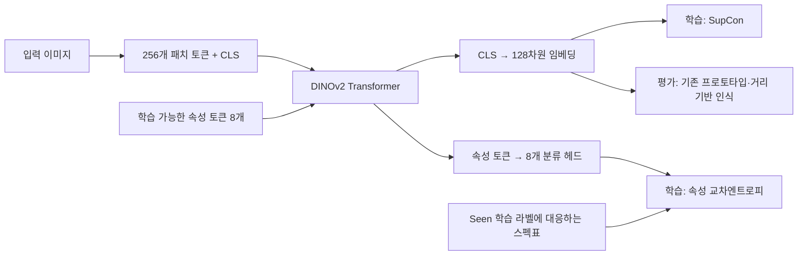

# 41클래스 8개 속성 토큰 실험 — 2026-09-27

## 실험 목적

임플란트 종류를 구분하는 이미지 임베딩을 학습하면서, 형태·연결 방식 등 **8개 속성을 동시에 예측하도록 DINOv2에 속성 토큰을 추가하는 실험**이다. 속성 학습이 이미지의 형태적 특징을 더 잘 반영하게 만들어, 학습하지 않은 클래스(Unseen)의 인식 성능을 높이는지 확인한다. 성능 개선은 아직 검증되지 않았다.

| 비교 대상 | 속성 사용 방식 | 이번 실험과의 차이 |
|---|---|---|
| `new_41class` | 속성 없이 이미지 임베딩만 SupCon으로 학습 | 동일한 41클래스 데이터의 이미지 전용 기준 실험 |
| 기존 속성 + 임베딩 결합 | 별도 속성 예측 결과와 이미지 유사도 점수를 결합 | 최종 점수 단계에서 결합 |
| 이번 `attr8_tokens_41class_20260927` | 이미지 패치와 속성 토큰을 같은 Transformer에서 공동 학습 | 모델 내부에서 결합하고, 최종 인식에는 이미지 임베딩 사용 |

## 학습과 추론 흐름

1. 224×224 이미지를 14×14 패치로 나누어 256개 이미지 패치 토큰을 만든다.
2. CLS·이미지 패치 토큰에 **학습 가능한 속성 토큰 8개**를 붙인다. 이 토큰들은 이미지마다 정답 속성값을 넣는 입력이 아니라, 속성별 특징을 학습하는 파라미터다.
3. 같은 Transformer의 self-attention을 통해 이미지 토큰과 속성 토큰이 정보를 주고받는다.
4. CLS에서 얻은 특징은 128차원 임베딩으로 변환하고 SupCon으로 학습한다. 같은 클래스는 가깝게, 다른 클래스는 멀어지도록 학습하는 경로다.
5. 속성 토큰 8개는 각각 분류 헤드로 전달한다. 학습 이미지의 클래스에 대응하는 스펙표 속성을 정답으로 사용해 보조 손실을 계산한다.

- 전체 손실: `L = L_SupCon + (1/8) × Σ L_attribute`. 각 속성은 정답이 있는 샘플만 교차엔트로피 평균을 계산하며, 해당 배치에 유효한 정답이 없으면 그 속성 손실은 0이다.
- **추론 시 이미지별 입력은 이미지만 사용한다.** 평가 이미지의 정답 클래스로 스펙을 조회해 입력하지 않는다. 속성 예측 점수를 최종 거리 점수에 더하는 방식도 적용하지 않는다.
- `it(it)`와 `internal(in)`을 통합한 41클래스를 사용한다. Seen 26클래스로 모델을 학습하고, 기존 평가 절차에 따라 Seen·Unseen 15클래스 인식 성능을 확인한다.
- 제외한 속성: `Connection_2`, `Apex_Hole`, `Body_Type`. `Body_Type`은 확인한 스펙표에서 모두 `Threaded`였다.

## 확인된 상태

- 본 학습 시작: 2026-09-27 12:32:33 KST. 서버 로그는 03:32:33 UTC.
- 12:33:18 KST 화면 확인: V100 32GB 사용률 93%, 메모리 27,452 MiB, Python 학습 프로세스 동작.
- 첫 에포크 결과, 최적 체크포인트 생성, 최종 평가 결과는 아직 확인하지 않음.
- 서버 작업은 Windows App `localhost:3389`의 원격 VS Code 화면과 화상키보드로 수행. 로컬 SSH·파일 전송 사용 없음.

## 모델과 데이터

- DINOv2 `vit_base_patch14_dinov2.lvd142m`, 입력 224×224, 패치 14×14.
- 속성 순서: `System`, `Connection_1`, `Flange`, `Collar`, `Microthread`, `Body_Shape`, `Thread_Shape`, `Apex_Shape`.
- 학습 가능한 속성 토큰 8개를 백본 `norm_pre` 입력에 추가. 기존 위치 임베딩 처리 후 이미지 토큰과 함께 Transformer 블록을 통과.
- 백본 최종 `norm` 출력의 마지막 8개 토큰에 속성별 분류 헤드 적용.
- 손실: 기존 SupCon + 8개 속성 교차엔트로피의 평균. 속성 정답 `-1`은 손실에서 제외.
- 추론 입력은 이미지뿐. 정답 클래스나 정답 속성을 이미지 입력 경로에 주입하지 않음.
- 속성표 정답은 학습용 보조 손실에서만 사용. 모델 생성 시 seen 클래스 목록·속성 어휘를 학습 매니페스트와 실험용 스펙표 사본에서 재구성.
- 기존 `src/attributes/spec_table.py` 정규화·매핑 재사용. 클래스 및 속성 순서 일치 검사 추가.
- 매니페스트: `data/new_41class/manifest_closed26.csv`, `manifest_open15.csv`, `manifest_full41.csv`.
- 학습 Seen 26 / 평가 Unseen 15. 코드 프로토콜 문자열 `closed27_open15` 유지.

## 설정

- 최대 5에포크, patience=2, batch_size=128, samples_per_class=8, seed=42.
- 검증 Macro-F1 개선 시 `best.pt` 저장. 기존 학습 코드의 얼리 스토핑 및 저장 로직 재사용.
- 기존 평가 그리드를 유지. 이전 M7과 동일한 gallery covariance 평가 경로를 포함하므로 strict-5-shot 결과로 해석하면 안 됨.
- 원본 코드·설정·데이터·기존 `new_41class` 결과 보존. 기존 컨테이너에서 코드 복사 후 새 실험 사본만 변경.
- 데이터·체크포인트·seg_data·실험 코드·설정은 컨테이너에 읽기 전용으로 연결. 네트워크 차단, HF/Transformers offline.

## 서버 경로

- 컨테이너: `attr8_tokens_41class_20260927`
- 실험 기록: `/home/ubuntu/aihub_run_new/outputs/experiment_records/attr8_tokens_41class_20260927/`
- 구현: 기록 폴더의 `src/metric/attribute_tokens.py`, `models.py`, `train.py`.
- 설정 사본: 기록 폴더의 `configs/`.
- 재현용 실행 인자: 기록 폴더의 `launch.json`.
- GPU 검증: 기록 폴더의 `smoke.py`, `smoke.log`, `smoke.pt`.
- 결과: `/home/ubuntu/aihub_run_new/outputs/metric/attr8_tokens_41class_20260927/closed27_open15_dinov2_supcon/`
- 학습 메타데이터: 결과 폴더의 `train/attributes.json`.
- 예정 체크포인트: 결과 폴더의 `train/checkpoints/best.pt`.

## 완료한 검증

- 실제 Docker 이미지의 DINOv2, CUDA, 임의 이미지 4장 배치로 실행.
- `SMOKE_OK`, 종료 코드 0을 원격 화면에서 확인.
- 손실 유한성, forward/backward, 속성 토큰의 0보다 큰 gradient norm 확인.
- 8개 속성 출력, 128차원 임베딩, 속성 순서 확인.
- 모든 속성 정답을 -1로 설정하면 보조 손실이 0인지 확인.
- optimizer step, 체크포인트 저장 및 동일 모델에 strict 복원, eval 출력 일치 확인. 별도로 재생성한 모델에 대한 복원 검증은 아님.
- 실제 데이터 전체 평가나 성능 개선 검증을 의미하지 않음.

## 후속 확인

비교 기준은 같은 41클래스 이미지 전용 `new_41class`의 전체·Seen·Unseen 정확도와 Macro-F1이다. 프로토타입 방식, 거리 함수, gallery 및 공분산 추정 조건을 맞춰 비교한다. 이전 42클래스 M7 결과는 라벨 구성이 달라 참고 비교로만 사용한다. 기존 실행의 patience=12에서 이번에는 2로 바뀌었으므로, 실제 학습 에포크 수도 함께 기록한다.

1. 컨테이너 로그와 `train/metrics/history.csv`에서 에포크·검증 Macro-F1 확인.
2. `best.pt` 생성 및 patience=2 작동 확인.
3. 컨테이너 종료 코드와 평가 CSV 확인 후, 같은 41클래스 이미지 전용 실험과 비교.
4. 완료 결과 확인 전에는 성능 개선이나 학습 완료로 기록하지 않음.
