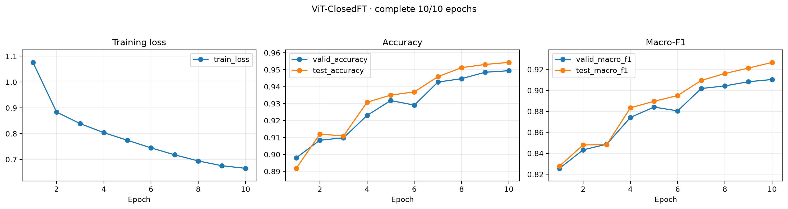
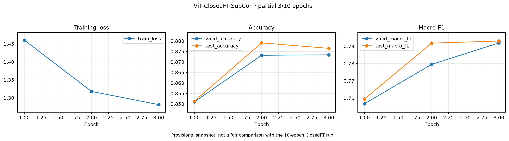
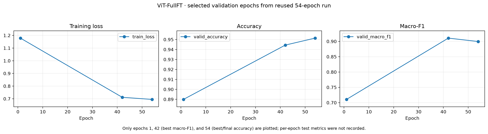

# Metric Learning 진단 실험 최종 보고서

작성일: 2026-07-24

## 1. 실험 목적

metric learning의 낮은 성능 원인을 다음 여섯 질문으로 나눠 진단했다.

1. 일반 ImageNet feature와 비교할 때 closed-set fine-tuning이 표현력을 저하하는가?
2. SupCon이 feature representativeness에 도움이 되는가?
3. closed 27개와 open 15개를 모두 학습한 FullFT가 더 좋은가?
4. Euclidean vector distance와 cosine similarity 중 어느 것이 좋은가?
5. GT, Mean, SS 중 어느 prototype이 좋은가?
6. 성능 저하가 open-set과 closed-set 중 어디에 집중되는가?

## 2. 계획된 실험 계약

### 모델

| 모델 | 계획된 학습 범위 | 목적 |
|---|---|---|
| ViT-Base | ImageNet pretrained, 추가 학습 없음 | 일반 feature 기준선 |
| ViT-ClosedFT | closed 27-label CE fine-tuning | closed-set FT 효과 |
| ViT-ClosedFT-SupCon | closed 27-label SupCon fine-tuning | closed-set SupCon 효과 |
| ViT-FullFT | closed+open 42-label CE fine-tuning | full-set 학습 효과 |
| ViT-FullFT-SupCon | closed+open 42-label SupCon fine-tuning | full-set SupCon 효과 |

### Prototype 및 거리

| 항목 | 정의 |
|---|---|
| GT-prototype | Yonsei에서 제공한 GT 이미지의 클래스별 embedding 평균 |
| Mean-prototype | training split 전체 embedding의 클래스별 평균 |
| SS-prototype | training split에서 seed로 고정한 일부 샘플의 클래스별 평균 |
| Euclidean | prototype과 query embedding의 L2 거리 |
| Cosine | prototype과 query embedding의 cosine similarity |

계획상 valid/test의 모든 query는 42개 prototype을 후보로 분류하고, 동일한
42-way 예측에서 all/closed/open 성능을 각각 계산해야 했다. Prototype과
distance의 최종 선택은 validation으로만 수행하도록 설계했다.

## 3. 확보된 산출물

| 항목 | 상태 | 사용할 수 있는 근거 |
|---|---|---|
| ViT-Base GT27 평가 | 완료 | accuracy, macro-F1 |
| ViT-ClosedFT 학습곡선 | 완료 | 10/10 epoch |
| ViT-ClosedFT-SupCon 학습곡선 | 부분 | 3/10 epoch까지만 로컬 보존 |
| ViT-FullFT 학습곡선 | 기존 run 재사용 | 54 epoch validation 기록 |
| ViT-FullFT-SupCon 학습곡선 | 없음 | GT27 평가 수치만 보존 |
| 5개 모델 GT-prototype 평가 | 완료 | 27-label, Euclidean/Cosine |
| Mean/SS 정량 평가 | 없음 | prototype t-SNE/coverage 일부만 보존 |
| closed/open 분리 성능 | 없음 | open-set 정량 결과 미보존 |
| 공통 query t-SNE | 일부 | 모델·checkpoint provenance가 불완전한 화면 포함 |
| canonical 180행 결과 | 없음 | `metrics.csv`/최종 집계 파일 미보존 |

원래 계획한 `5 models × 3 prototypes × 2 distances ×
2 queries × 3 groups = 180`개 정량 행은 완성되지 않았다. 현재 비교에는
동일한 52개 query를 사용한 5개 모델의 GT-prototype 10개 결과만 쓸 수 있다.

초기 진단 코드는 `vit_large_patch16_224.augreg_in21k_ft_in1k`를 사용했지만,
후속 독립 pipeline은 `vit_base_patch16_224`를 기본값으로 사용한다. GT27
raw model spec이 남아 있지 않아 표의 다섯 모델이 어느 구현에서 추출됐는지
로컬에서 재검증할 수 없다. 따라서 모델 간 architecture/preprocessing 동일성도
현재 provenance 한계에 포함한다.

## 4. 데이터와 실제 GT27 평가 프로토콜

2026-07-22에 `/workspace/data/GT_data_42label/AI Hub Data`를 검사한 결과다.

- 42개 라벨 폴더 중 이미지가 있는 27개만 사용
- 총 241장
- seed 2026 고정
- support 189장 / query 52장
- backbone embedding에서 라벨별 support 평균 prototype 1개 생성
- 동일 query를 모든 모델에 사용
- 27-way nearest-prototype 분류
- Euclidean 및 cosine 비교
- 지표: accuracy, macro-F1

이 평가는 계획된 canonical 42-way valid/test 평가와 다르다. 특히 15개
open label을 포함하지 않으며, 독립 train split으로 만든 Mean/SS prototype도
사용하지 않는다. 따라서 아래 결과는 27-label GT few-shot
nearest-class-mean 평가로 해석해야 한다.

### 희소성

- 27개 중 13개 클래스는 전체 이미지가 3장뿐이어서 support 2장/query 1장이다.
- 16개 클래스는 query가 단 1장이다.
- query 한 장이 전체 accuracy를 1.92%p 바꾼다.
- `vit_band_6b_lam0.8.pt` cosine 32/52의 Wilson 95% 신뢰구간은 약
  48.0~73.5%다.

## 5. 학습 결과

| 모델 | 기록 상태 | 기준 epoch | Validation Acc. | Validation Macro-F1 | Test Acc. | Test Macro-F1 |
|---|---:|---:|---:|---:|---:|---:|
| ViT-Base | 추가 학습 없음 | - | - | - | - | - |
| ViT-ClosedFT | 10/10 완료 | 10 | 94.94% | 91.04% | 95.43% | 92.67% |
| ViT-ClosedFT-SupCon | 3/10까지만 보존 | 3 | 87.34% | 79.19% | 87.65% | 79.30% |
| ViT-FullFT | 기존 54-epoch run | 42 F1 / 54 Acc. | 95.14% | 91.06% | 미기록 | 미기록 |
| ViT-FullFT-SupCon | 학습 기록 없음 | - | - | - | - | - |

ClosedFT와 FullFT의 validation 최고값은 거의 같지만, 각각 27-label 10 epoch와
42-label 54 epoch이므로 동일 조건 비교가 아니다. SupCon의 3-epoch 수치도
ClosedFT 10-epoch와 직접 비교해 loss 효과로 해석할 수 없다.

### ViT-ClosedFT

Epoch 1→10에서 train loss는 1.0761→0.6656, validation accuracy는
89.80→94.94%, test macro-F1은 82.79→92.67%로 개선됐다.

### ViT-ClosedFT-SupCon

보존된 세 epoch에서 train loss는 1.4605→1.2811, validation accuracy는
85.10→87.34%, test macro-F1은 75.95→79.30%로 개선됐다. 10-epoch 완료
여부와 최종 checkpoint 선택 근거는 로컬에서 검증할 수 없다.

### ViT-FullFT

기존 54-epoch 기록에서 최고 validation macro-F1은 epoch 42의 91.06%,
최고 validation accuracy는 epoch 54의 95.14%다. Per-epoch test 지표는 없다.

## 6. 5개 모델 GT-prototype 결과

단위: %

| 모델 | Euclidean Acc. | Euclidean Macro-F1 | Cosine Acc. | Cosine Macro-F1 |
|---|---:|---:|---:|---:|
| ViT-Base | **48.08** | **51.28** | **51.92** | **52.80** |
| ViT-ClosedFT | 44.23 | 42.21 | 44.23 | 42.46 |
| ViT-ClosedFT-SupCon | 44.23 | 47.92 | 40.38 | 43.08 |
| ViT-FullFT | **51.92** | **52.44** | 50.00 | 50.59 |
| ViT-FullFT-SupCon | 42.31 | 42.79 | 42.31 | 41.55 |
| **5모델 평균** | **46.15** | **47.33** | **45.77** | **46.10** |

같은 GT27 benchmark 전체 12개 checkpoint 중 최고 top-1은
`vit_band_6b_lam0.8.pt`의 cosine accuracy 61.54%였다. 이는 보고 대상
5개 canonical 모델보다 높지만, 별도 Band-loss 학습이므로 아래 실험 간
비교표에는 포함하지 않았다.

## 7. 계획된 실험별 판정

### Experiment 1a: Euclidean, Base vs ClosedFT vs ClosedFT-SupCon

| 비교 | Accuracy 변화 | Macro-F1 변화 | 판정 |
|---|---:|---:|---|
| ClosedFT − Base | -3.85%p | -9.07%p | FT가 GT27 metric 표현을 저하시킴 |
| ClosedFT-SupCon − Base | -3.85%p | -3.36%p | Base를 회복하지 못함 |
| ClosedFT-SupCon − ClosedFT | 0.00%p | +5.71%p | accuracy 개선 없이 F1만 일부 회복 |

### Experiment 1b: Cosine, Base vs ClosedFT vs ClosedFT-SupCon

| 비교 | Accuracy 변화 | Macro-F1 변화 | 판정 |
|---|---:|---:|---|
| ClosedFT − Base | -7.69%p | -10.34%p | FT가 GT27 metric 표현을 저하시킴 |
| ClosedFT-SupCon − Base | -11.54%p | -9.72%p | 세 모델 중 가장 낮은 accuracy |
| ClosedFT-SupCon − ClosedFT | -3.85%p | +0.62%p | 실질적 개선으로 보기 어려움 |

Experiment 1 판정: 이 GT27 backbone 평가에서는 일반 ViT-Base가
ClosedFT와 ClosedFT-SupCon보다 모두 좋았다. Closed-set fine-tuning이
학습 라벨의 classifier 성능은 높였지만, 소수 GT prototype으로 판정할 때
필요한 일반 표현은 약화됐다는 해석이 가장 타당하다.

### Experiment 2a: Euclidean, ClosedFT vs FullFT

| 비교 | Accuracy 변화 | Macro-F1 변화 |
|---|---:|---:|
| FullFT − ClosedFT | +7.69%p | +10.23%p |

### Experiment 2b: Cosine, ClosedFT vs FullFT

| 비교 | Accuracy 변화 | Macro-F1 변화 |
|---|---:|---:|
| FullFT − ClosedFT | +5.77%p | +8.13%p |

Experiment 2 판정: CE 모델끼리는 FullFT가 ClosedFT보다 두 거리에서
모두 좋았다. 더 다양한 42개 라벨 학습이 closed-only CE보다 일반 표현을
보존했을 가능성이 있다. 다만 FullFT는 기존 54-epoch run이고 ClosedFT는
fresh 10-epoch run이므로 데이터 범위만의 효과로 분리할 수 없다.

### Experiment 4a: Euclidean, ClosedFT vs ClosedFT-SupCon

| 비교 | Accuracy 변화 | Macro-F1 변화 |
|---|---:|---:|
| ClosedFT-SupCon − ClosedFT | 0.00%p | +5.71%p |

### Experiment 4b: Cosine, ClosedFT vs ClosedFT-SupCon

| 비교 | Accuracy 변화 | Macro-F1 변화 |
|---|---:|---:|
| ClosedFT-SupCon − ClosedFT | -3.85%p | +0.62%p |

Experiment 4 판정: ClosedFT-SupCon은 top-1 accuracy를 개선하지
못했다. Euclidean macro-F1은 좋아졌지만 cosine에서는 차이가 작다.
학습 epoch와 checkpoint provenance가 완전하지 않아 SupCon의 효과를
확정하기보다 "도움이 된다는 증거가 없음"으로 판정한다.

### Experiment 5a: Euclidean, FullFT vs FullFT-SupCon

| 비교 | Accuracy 변화 | Macro-F1 변화 |
|---|---:|---:|
| FullFT-SupCon − FullFT | -9.61%p | -9.65%p |

### Experiment 5b: Cosine, FullFT vs FullFT-SupCon

| 비교 | Accuracy 변화 | Macro-F1 변화 |
|---|---:|---:|
| FullFT-SupCon − FullFT | -7.69%p | -9.04%p |

Experiment 5 판정: 보존된 GT27 backbone 결과에서는 FullFT-SupCon이
FullFT보다 명확히 낮다. 이 조건에서는 SupCon이 representativeness를
개선하지 못하고 오히려 저하시켰다.

## 8. 여섯 연구 질문에 대한 수치 기반 답변

판정 원칙은 다음과 같다.

- 동일 GT27 query 52장에서 얻은 수치만 주 결론에 사용한다.
- Accuracy와 macro-F1을 함께 본다.
- 필요한 실험 행이 없는 질문은 추정하지 않고 판정 대상에서 제외한다.

### 8.1 수치로 답할 수 있는 질문: 4/6

#### Q1. ClosedFT가 Base보다 일반 표현을 저하하는가?

답: 이 GT27 backbone 평가에서는 저하했다.

| 거리 | Base Acc./F1 | ClosedFT Acc./F1 | ClosedFT − Base |
|---|---:|---:|---:|
| Euclidean | 48.08% / 51.28% | 44.23% / 42.21% | **-3.85%p / -9.07%p** |
| Cosine | 51.92% / 52.80% | 44.23% / 42.46% | **-7.69%p / -10.34%p** |

두 거리 모두에서 ClosedFT의 accuracy와 macro-F1이 Base보다 낮다. 따라서
closed 27-label classifier fine-tuning은 학습 분류 성능을 높였지만, 소수
GT centroid로 평가한 일반 metric 표현은 약화시켰다.

#### Q2. SupCon이 representativeness에 도움이 되는가?

답: Top-1 accuracy를 개선하지 못했으며, FullFT 조건에서는 명확히
저하시켰다.

| 비교 | 거리 | Accuracy 변화 | Macro-F1 변화 |
|---|---|---:|---:|
| ClosedFT-SupCon − ClosedFT | Euclidean | 0.00%p | +5.71%p |
| ClosedFT-SupCon − ClosedFT | Cosine | -3.85%p | +0.62%p |
| FullFT-SupCon − FullFT | Euclidean | **-9.61%p** | **-9.65%p** |
| FullFT-SupCon − FullFT | Cosine | **-7.69%p** | **-9.04%p** |

Closed 조건에서는 Euclidean macro-F1만 +5.71%p 회복됐지만 accuracy는
개선되지 않았고, cosine accuracy는 오히려 -3.85%p였다. Full 조건에서는
두 거리의 두 지표가 모두 7.69~9.65%p 감소했다. 따라서 현재 수치에는
SupCon이 더 대표적인 backbone feature를 만든다는 근거가 없다.

#### Q3. Full-set 학습이 closed-only 학습보다 도움이 되는가?

답: CE 모델 비교에서는 도움이 됐다.

| 거리 | ClosedFT Acc./F1 | FullFT Acc./F1 | FullFT − ClosedFT |
|---|---:|---:|---:|
| Euclidean | 44.23% / 42.21% | 51.92% / 52.44% | **+7.69%p / +10.23%p** |
| Cosine | 44.23% / 42.46% | 50.00% / 50.59% | **+5.77%p / +8.13%p** |

FullFT가 두 거리에서 accuracy 5.77~7.69%p, macro-F1 8.13~10.23%p
높았다. 다만 FullFT 54 epoch와 ClosedFT 10 epoch의 조건 차이가 있으므로
향상을 full-set 데이터 효과 하나로만 귀속할 수는 없다.

#### Q4. Euclidean과 cosine 중 어느 거리가 좋은가?

답: 5모델 평균은 Euclidean이 소폭 높지만, 실질적으로는 비슷하다.

| 거리 | 5모델 평균 Accuracy | 5모델 평균 Macro-F1 |
|---|---:|---:|
| Euclidean | **46.15%** | **47.33%** |
| Cosine | 45.77% | 46.10% |
| Euclidean − Cosine | **+0.39%p** | **+1.23%p** |

Query 한 장이 accuracy 1.92%p를 바꾸는 반면 평균 거리 차이는 accuracy
0.39%p다. 따라서 관측 평균 승자는 Euclidean이지만, 주된 병목은 거리식이
아니라 embedding과 prototype 대표성이다.

### 8.2 결과 부족으로 판정에서 제외한 질문: 2/6

#### Q5. GT, Mean, SS 중 어느 prototype이 좋은가?

본 42-label 결론에서 제외한다. 동일 query에서 필요한
`5 models × 3 prototypes × 2 distances = 30`개 조건 중 GT 10개만
남아 있고 Mean/SS 20개가 없다. 따라서 세 prototype의 수치 순위를 만들 수
없다.

별도의 uncropped 7→3 실험에서는 모델 전체 평균 macro-F1이 Mean 48.26%,
GT 45.10%, SS 36.77%로 Mean이 가장 안정적이었다. 이는 다른 데이터셋의
보조 근거일 뿐 본 42-label 질문의 답으로 대체하지 않는다.

#### Q6. 성능 저하가 open-set과 closed-set 중 어디에 집중되는가?

본 42-label 결론에서 제외한다. 보존된 GT27 결과는 52개 query를 하나의
27-way pool로 평가했고, open/closed group별 정량 행은 0개다. 따라서
open과 closed의 accuracy/F1 차이를 계산할 수 없다.

## 9. Metric 정확도가 낮은 이유

### 9.1 희소하고 비대표적인 support/query: 확신도 높음

27개 중 13개 클래스가 세 장뿐이다. 다음 세 라벨은 12개 checkpoint에서
모두 recall 0이었다.

- `14_NeoBiotech_EB`
- `27_Cowellmedi_Atlas_External`
- `31_Straumann_TS_Standard`

이들 클래스는 support가 fixture-only 형태에 치우친 반면 query에는 긴 상부
구조물이 결합된 이미지가 포함돼, 두 장의 평균 prototype이 query 변이를
대표하지 못했다.

### 9.2 클래스당 평균점 하나의 한계: 확신도 높음

현재 평가는 learned metric classifier가 아니라 backbone feature를 클래스당
centroid 하나로 축약한 nearest-class-mean baseline이다. 촬영 조건, 직경,
길이, 상부 구조물 유무처럼 클래스 내부에 여러 모드가 있으면 한 평균점으로
표현하기 어렵다.

반복적으로 나타난 cosine 오분류는 다음과 같다.

- NeoBiotech IS II → IS III: 20회
- Osstem USII → USIII: 14회
- Dentium Superline → Implantium: 9회
- Osstem SSII → SSIII: 8회
- Osstem TSIII → USII: 7회

### 9.3 정답은 가깝지만 top-1 경계가 약함: 확신도 높음

`vit_band_6b_lam0.8.pt` cosine 기준:

- Top-1: 61.54%
- Top-3: 84.62%
- Top-5: 92.31%
- 평균 정답 rank: 2.21

Embedding이 제품 정보를 전혀 잃은 것이 아니라, 정답이 가까운 후보에는
들어오지만 유사한 형제 클래스 사이의 1등을 단일 centroid가 안정적으로
결정하지 못하는 형태다.

### 9.4 학습 목적과 평가 representation 불일치: 확신도 중상

- CE/Band 모델은 classifier decision boundary를 중심으로 학습됐다.
- 평가는 classifier head를 제거하고 backbone centroid 거리만 사용했다.
- SupCon은 normalized projection head에서 loss를 받지만 GT27 평가는
  backbone embedding을 사용했다.

따라서 SupCon이 직접 최적화한 공간과 실제 평가 공간이 다르다. 다만 별도
uncropped 7→3 실험에서는 SupCon projection도 backbone보다 낮았으므로,
projection을 쓰는 것만으로 문제가 해결된다는 근거는 없다.

### 9.5 224 입력에서 미세 형상 손실 가능성: 확신도 중간

전체 방사선 이미지를 224×224로 축소하면 thread, neck, taper, connection
차이가 적은 픽셀과 ViT patch로 표현된다. 별도 uncropped 7→3 감사에서는
implant 외접박스 면적 중앙값이 화면의 5.53%였고, 32.65%의 implant 짧은
변이 ViT-B/16 patch 한 칸보다 작았다. GT27에 동일한 ROI 통계는 없지만
같은 실패 메커니즘이 작동할 가능성이 있다.

### 9.6 작은 query와 macro-F1 분산: 확신도 높음

Query가 한 장인 16개 클래스는 한 번 틀리면 해당 클래스 recall/F1이 0이 된다.
따라서 52장 accuracy뿐 아니라 macro-F1도 split에 매우 민감하다. 단일 seed
순위는 반복 split 또는 leave-one-out 없이 확정적 모델 순위로 사용하면 안 된다.

## 10. t-SNE 및 prototype 시각화

### 42-label classifier 참고 화면

여러 라벨이 큰 영역 안에서 섞여 있다. 화면에 checkpoint와 manifest 경로가
없으므로 정량 판정 근거가 아니라 참고 자료로만 사용한다.

### GT/cosine metric embedding 참고 화면

일부 라벨은 국소적으로 모이지만 여러 영역에서 라벨 혼합이 보인다. t-SNE는
거리 구조를 왜곡할 수 있으므로 원공간의 prototype accuracy/F1을 우선한다.

### ClosedFT SS-prototype 참고 화면

이전 실행에서 GT 26점, Mean 42점, SS 42점의 총 110개 prototype 좌표가
생성됐다. 당시 GT는 alias mapping 문제로 closed 20/open 6만 연결됐다.
이후 GT27 benchmark는 비어 있지 않은 폴더 27개를 직접 사용했으므로 두
실행의 GT coverage 계약이 다르다.

## 11. 결론

현재 근거만으로 "metric learning 코드가 동작하지 않는다"고 결론낼 수는 없다.
Classifier 학습 성능은 높고, GT27에서도 정답의 Top-3/Top-5 순위는 상당히
높다. 낮은 성능은 다음 요인이 겹친 결과로 보인다.

1. 적고 비대표적인 GT support/query
2. 다봉 클래스 분포를 prototype 하나로 축약하는 결정 규칙
3. source-label 분리를 최적화한 fine-tuning과 GT metric 평가 목적의 불일치
4. SupCon projection이 아닌 backbone을 평가한 representation 불일치
5. 224 uncropped 입력에서 미세 형상 손실
6. 52장 단일 query split의 큰 통계적 분산

보존된 수치에서는 Base가 ClosedFT/SupCon보다 일반적인 GT metric 표현을
잘 유지했고, CE FullFT는 CE ClosedFT보다 좋았다. 반면 SupCon은 closed와
full 조건 모두 top-1 개선을 만들지 못했다. 거리식의 평균 차이는 작아
병목은 Euclidean/cosine 선택보다 embedding과 prototype 대표성에 있다.

## 12. 미완료 항목과 재실행 우선순위

원래 실험 질문에 답하려면 다음 항목을 재실행해야 한다.

1. 동일 seed/epoch/config로 네 fine-tuned 모델을 다시 학습하고 history 보존
2. Base 포함 다섯 모델의 공통 backbone을 동일 architecture/preprocessing으로 추출
3. 42/42 GT alias 및 content-leakage audit 통과
4. valid/test × GT/Mean/SS × Euclidean/cosine × all/closed/open 180행 생성
5. validation으로 prototype/distance를 선택하고 test는 한 번만 보고
6. SupCon projector는 보조 결과로 backbone과 직접 비교
7. 최소 3 seed 또는 grouped repeated split과 신뢰구간 보고
8. mean 대비 medoid, 1-NN/k-NN, multi-prototype 비교
9. ROI crop 및 384/512 입력 비교

현재 canonical 180행과 raw prediction이 없으므로 이 문서 이후에 숫자 표만
임의로 보완해서는 안 된다. 재실행 결과가 생기면 본 문서의 7~8절을 새
validation-selected 결과로 교체해야 한다.

## 13. 근거 위치

- 실험 계획: `../../.omx/plans/metric-learning-diagnosis-42class.md`
- 이전 중간 보고서: `METRIC_DIAGNOSIS_CURRENT_RESULTS.md`
- 보존된 GT27 결과표: `../../implantsj/README.md`의 11절
- 정량 평가·보고서 생성 코드: `../../pipelines/eval/evaluate_metric_diagnosis.py`
- 독립 pipeline 보고 코드: `../../implantsj/implantsj/reporting.py`
- GitHub 보고: <https://github.com/tria-lab/ImplantID/issues/14>
- 별도 uncropped 7→3 보고서:
  `full_uncropped_7to3_metric/report/REPORT.md`
